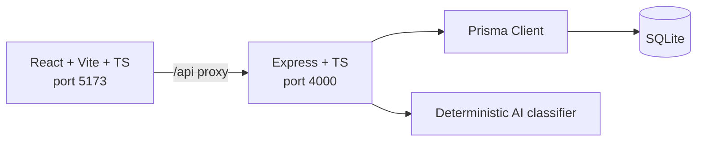

# TicketSense

**AI-powered customer support / ITSM ticketing platform.** A portfolio
project demonstrating full-stack engineering + business analysis on a
single, real, buildable codebase — no mocked data, no fake buttons.

## Business problem & solution

Mid-market support teams triage tickets manually, discover SLA breaches
reactively (usually from an angry customer), and assign work ad hoc. 
TicketSense replaces that with:

- A **deterministic, keyword/rule-based AI classifier** that suggests
  category, subcategory, sentiment, and priority with a confidence score
  and human-readable reasoning — no external API key required, ever.
- A **configurable, ordered assignment engine** (round robin / least-active
  / category-based / priority escalation to senior agents or an escalation
  team).
- A **business-hours-aware SLA clock** with automatic due-date calculation
  and a breach-detection sweep.
- A **real analytics dashboard** computed from stored ticket/SLA data, not
  hardcoded numbers.

See `docs/product-vision-and-brd.md` for the full business case and
personas.

## Target users

Support Agent, Support Manager, Super Admin, Readonly Analyst — see
`docs/product-vision-and-brd.md` §2 for persona detail.

## What's implemented (MVP) vs planned

This is a scoped MVP, not the full enormous original spec. Everything
listed below is real and working end-to-end; anything not listed is
explicitly deferred — see `docs/roadmap.md` for the complete breakdown
(including what was deliberately **not** built, like the visual Automation
Studio and real LLM integration).

**Implemented:**
- Ticket CRUD with an enforced state machine (New → Open → In Progress →
  Pending → Resolved → Closed, plus controlled Reopen) and bulk actions.
- Deterministic AI classification + accept/reject/edit review workflow.
- Rule-based assignment engine with a dry-run preview.
- SLA policies, business-hours-aware due dates, breach detection.
- Dashboard with 11 KPIs and 6 charts, all filterable, all real.
- Knowledge base with keyword-overlap suggested articles.
- Reports (agent productivity, category bottlenecks, SLA compliance) with
  CSV export and drill-down.
- Role-based access control enforced server-side on every protected route.
- Light/dark theme, toasts, confirmation modals, loading/empty/error states.
- 18 passing automated backend tests.

**Planned (not built here):** real LLM provider integration, visual
automation/workflow builder, advanced ML-based routing, PostgreSQL
migration, SSO, mobile apps, duplicate-ticket detection, optimistic
locking. Full detail in `docs/roadmap.md`.

## Architecture



Full architecture, ERD, and ADRs (why SQLite+Prisma, why a deterministic
classifier is the default, etc.) in `docs/architecture.md`.

## Tech stack

- **Server:** Node.js, TypeScript, Express, Prisma ORM, SQLite, Zod, JWT (jsonwebtoken), bcryptjs.
- **Client:** React, TypeScript, Vite, Tailwind CSS, lucide-react, Recharts, React Router.
- **Testing:** Vitest + Supertest against an isolated SQLite test database.
- **Monorepo:** npm workspaces (`server`, `client`).

## Install & run

Requires Node.js 18+.

```bash
# from the repo root
npm install              # installs both workspaces
npm run seed              # resets & seeds the SQLite dev database (~120 tickets)
npm run dev                # runs server (:4000) and client (:5173) together
```

Then open **http://localhost:5173**. The Vite dev server proxies `/api/*`
to the Express server, so you only need to open the client URL.

Other useful root scripts:
```bash
npm run build              # type-checks and builds both server and client
npm run test                # runs the backend test suite (vitest)
npm run migrate            # runs Prisma migrations (server workspace)
```

### Environment variables

Copy `server/.env.example` to `server/.env` (already done in this
checkout) and adjust if needed. Nothing is required to run the app:

| Variable | Required? | Default behavior |
|---|---|---|
| `PORT` | No | `4000` |
| `DATABASE_URL` | No | `file:./dev.db` (SQLite) |
| `JWT_SECRET` | No (but set your own for anything beyond local demo use) | dev default |
| `ORG_TIMEZONE` | No | `Asia/Kolkata` — used for business-hours SLA math |
| `AI_PROVIDER` / `AI_PROVIDER_API_KEY` | No, never | Deterministic classifier is always the working path; these are an unused seam for a future real LLM integration (see `docs/architecture.md` ADR-2) |

### Default login credentials (after `npm run seed`)

Password for every account: `Password123!`

| Role | Email |
|---|---|
| Super Admin | `admin@ticketsense.io` |
| Support Manager | `manager@ticketsense.io` |
| Support Agent | `agent1@ticketsense.io` (through `agent12@ticketsense.io`) |
| Readonly Analyst | `analyst@ticketsense.io` |

## Demo workflow walkthrough

1. **Log in** as `admin@ticketsense.io`.
2. **Overview** — see real KPI cards and charts computed from the ~120
   seeded tickets; try the team/agent/category/priority/date filters.
3. **Tickets → New Ticket** — create a ticket without specifying a
   priority. Open it and see the AI Recommendation panel: suggested
   category/subcategory/priority/sentiment with a confidence score and
   plain-English reasoning. Accept, reject, or edit it.
4. On the same ticket, click **Auto-Assign** to watch the rule-based
   engine pick a team/agent and log the reasoning to the activity
   timeline.
5. Try an invalid status change (e.g. New → Resolved) — it's rejected
   with the actual allowed next statuses. Walk it through New → Open →
   In Progress → Resolved → Closed, then **Reopen** it and note in the
   SLA panel that the resolution countdown restarts while the
   first-response due date stays put (the documented reopen rule).
6. **SLA Management** — see the breach list and compliance trend, and
   trigger "Run Breach Detection" manually.
7. **Assignment Rules** — inspect the seeded rules (critical escalation,
   billing → billing ops, technical → tier 2, default round robin), try
   the **Dry Run** preview.
8. **AI Intelligence** — see the acceptance-rate stats across all
   historical AI recommendations.
9. **Reports** — export agent productivity or category bottlenecks to
   CSV; drill into a filtered ticket list from either report.

## Key business rules

- **State machine:** New → Open → In Progress → Pending → Resolved →
  Closed, with Reopen only from Resolved/Closed back to Open. Enforced
  server-side; invalid transitions return HTTP 400.
- **Reopen & SLA:** reopening resets the *resolution* due date (recomputed
  from "now") but leaves the *first-response* due date untouched, since the
  customer already got an initial response in the original lifecycle.
  Full detail in `docs/business-rules-and-sla.md`.
- **Assignment:** rules are evaluated in order; the first matching
  non-default rule wins, with a mandatory default fallback. Overloaded or
  inactive agents are excluded from every strategy.
- **AI confidence:** below 0.6, the classifier's reasoning text explicitly
  flags the suggestion for manual review rather than silently applying it.

## BA contributions summary

This project's business-analysis artifacts (all in `/docs`) include: a
BRD with personas and an explicit in/out-of-scope boundary
(`product-vision-and-brd.md`); a PRD with Gherkin-style acceptance criteria
for the four core flows (`prd-and-user-stories.md`); a documented state
machine, SLA calculation rules, and an exception-handling matrix covering
8 real failure modes (`business-rules-and-sla.md`); a requirements
traceability matrix mapping every listed test scenario to its requirement
and KPI formulas with exact denominators (`test-plan-and-traceability.md`);
and a roadmap that is explicit about what was *not* built, rather than
quietly omitting it (`roadmap.md`).

## Screenshots

Not included in this repository — there's no way to capture a live browser
session in the environment this was built in. To generate your own: run
`npm install && npm run seed && npm run dev`, open
`http://localhost:5173`, log in, and capture the Overview, Ticket Detail,
and SLA Management pages (dark mode included via the theme toggle).

## Roadmap

See `docs/roadmap.md` for the full MVP-delivered vs Phase 2/3/4 breakdown.
